# Second Opinion

> **Before a vulnerable person acts on a suspicious call, text or payment request, Alexa+ gives a spoken second opinion and holds the action until a trusted family member approves.**

Built for the **Build, Ship, Shape: Amazon Developer Hackathon 2026**: Alexa+ track, plus the Open Source and AWS Builder mini challenges.


## Contents
1. [In one minute](#in-one-minute)
2. [The problem](#the-problem)
3. [Run it](#run-it)
4. [Walkthrough with screenshots](#walkthrough-with-screenshots)
5. [How it works, end to end](#how-it-works-end-to-end)
6. [What is built](#what-is-built)
7. [Safety and security design](#safety-and-security-design)
8. [How well does the detector work?](#how-well-does-the-detector-work)
9. [Real versus simulated](#real-versus-simulated)
10. [Alexa+ readiness](#alexa-readiness)
11. [Testing and CI](#testing-and-ci)
12. [Configuration](#configuration)
13. [Project layout](#project-layout)
14. [How this fits the track](#how-this-fits-the-track)
15. [Limits and what is next](#limits-and-what-is-next)
16. [Documentation index](#documentation-index)

---

## In one minute
- A person at home asks a voice assistant to **pay or buy** something ("buy five $200 gift cards, the bank says I must today").
- **Second Opinion**, a real MCP server, checks the request with a **deterministic, explainable** risk engine plus the household's own rules.
- If it looks risky, the assistant says why in two kind sentences, **does not carry the action out**, and asks a trusted family member on their phone.
- The family member sees the same red flags and **approves or denies**. One or two approvers are required (the household chooses); any denial vetoes; unanswered requests escalate and then expire **blocked**.
- Ordinary requests (a $24 refill at the trusted pharmacy) go straight through.
- The voice assistant **can never approve its own holds**. Only the family console can.

## The problem
Scams work because they say *pay now*: gift cards, wire or crypto, a fake "bank security" call. The people most at risk are often alone at home with an assistant that will happily place an order, and family usually finds out afterwards. The assistant is exactly where the money moves, so that is where a second opinion belongs. We cannot listen to phone calls (Alexa+ does not hear them), so we gate the **pay and buy requests** and answer "is this a scam?" questions.

## Run it
Requires **Node 22.13 or newer**. No AWS account, no network, nothing to compile (SQLite is Node's built-in `node:sqlite`).

```bash
git clone https://github.com/Monolithic-Dev/second-opinion && cd second-opinion
npm install
npm run demo          # builds the web app on first run, then serves everything on http://localhost:3000/demo
```

| URL | What |
|---|---|
| http://localhost:3000/demo | Dorothy's simulated Echo and Priya's phone, side by side |
| http://localhost:3000/family | Family console (PINs: Priya `1234`, Arjun `5678`, demo credentials) |
| http://localhost:3001/mcp | The MCP server (Streamable HTTP, bearer token from `.env`, default `dev-token`) |
| http://localhost:3001/metrics | Prometheus metrics (same bearer token) |

**Docker:** `export MCP_AUTH_TOKEN=<24+ chars> SESSION_SECRET=<long random> FAMILY_PINS=p_priya:4821,p_arjun:7390 && docker compose up --build`. Production mode refuses default secrets.

**Verify everything:**
```bash
npm run typecheck && npm test      # 267 server-side tests + 33 web tests
npm run e2e                        # 17 real-browser tests (Playwright), including accessibility scans
```

## Walkthrough with screenshots

### 1. Start: Dorothy's Echo and the family phone
Everything on the left is the (simulated) Alexa+ device. The green badge shows the page is talking to the **real MCP server**.

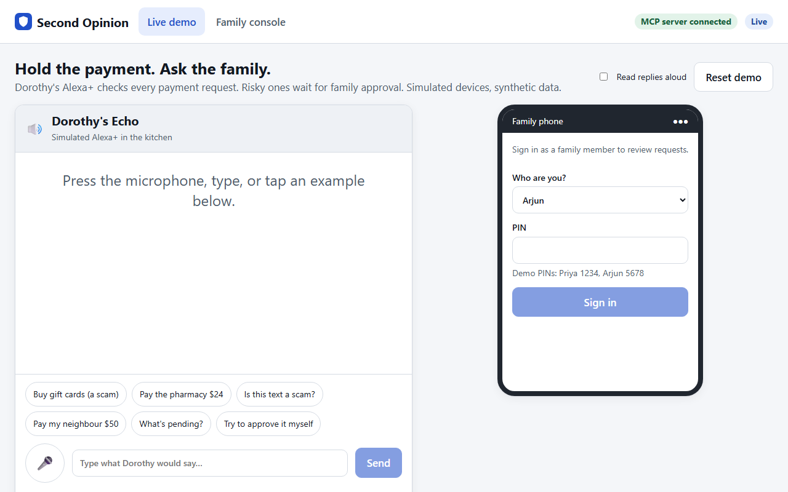

### 2. A normal request just works
"Pay the pharmacy $24": Greenleaf Pharmacy is on the family's trusted list and the amount is ordinary, so it is done with no friction. Second Opinion is not paranoid.

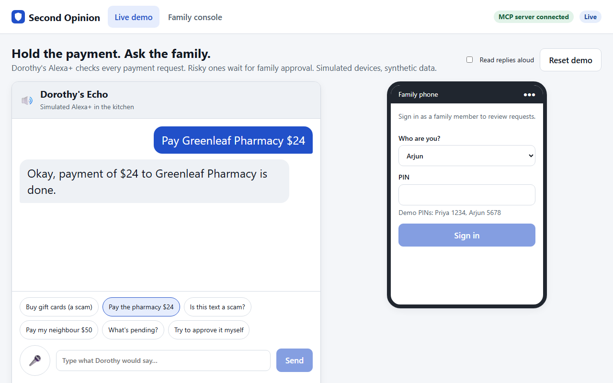

### 3. "Is this text a scam?"
Asking about a message gets a plain-language answer and the matching scam playbook. Nothing is paid, so no hold is created.

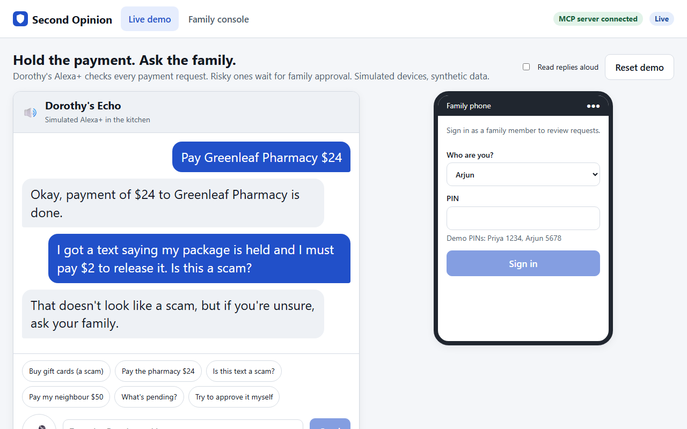

### 4. A scam request is paused (the hero moment)
"The bank says I have to buy five $200 gift cards today or my account is frozen." The reply is spoken and shown: what was found, why it matters, and that the family was asked. It also remembers that the same kind of request was refused earlier in the week.


### 5. The proof: the real MCP calls
The **Developer trace** lists the actual tool calls that happened (`check_message`, `place_hold`, `request_family_approval`) with timings and a trace id that follows the request all the way to the database row.

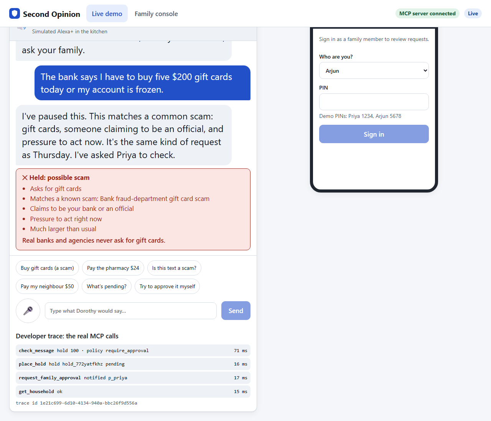

### 6. The family decides
Priya signs in on the phone and presses **Deny**. Dorothy's device tells her immediately, live: "Your family said no, so I've cancelled it. You're safe."

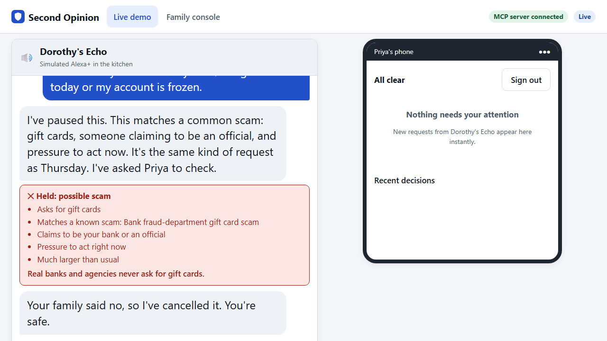

### 7. The Family Console
A full caregiver view for the people who protect Dorothy.

**Overview**: what needs a decision, and how much money has been protected.

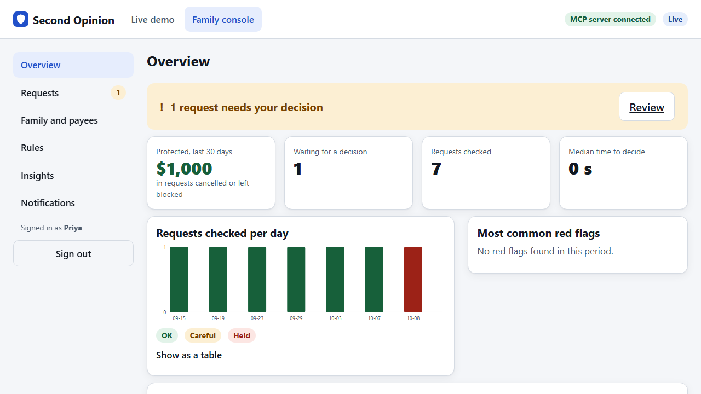

**Requests**: every held request with its status.

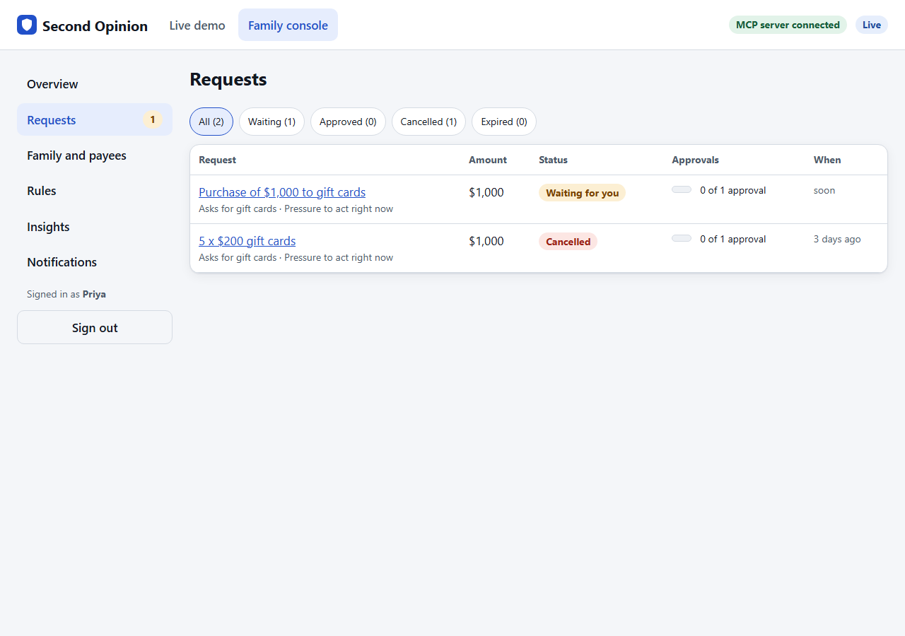

**Request detail**: the red flags, the household rules that applied, each approver's vote and the timeline. Shown here with two approvals required: one is in, the other is awaited.


**Family and payees**: who can approve, and the trusted list that makes ordinary payments frictionless.

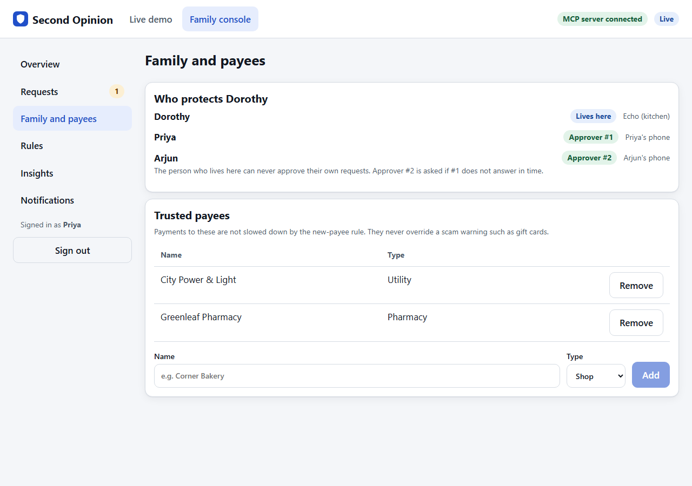

**Rules**: payment limits, new-payee wait, quiet hours, one or two approvals, escalation and expiry. Values are validated before saving, and the rules can only add friction.

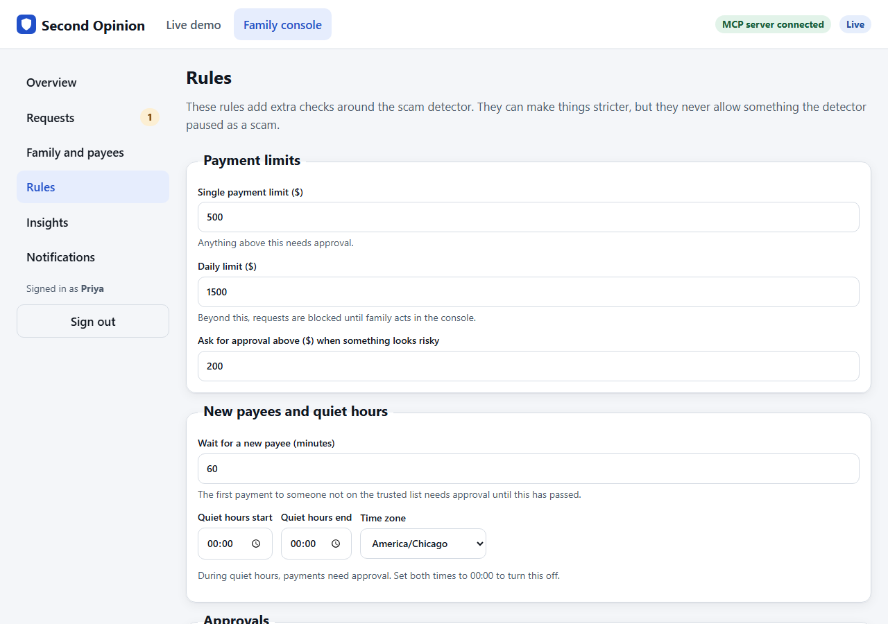

**Insights**: protected dollars, requests per day, the most common red flags.

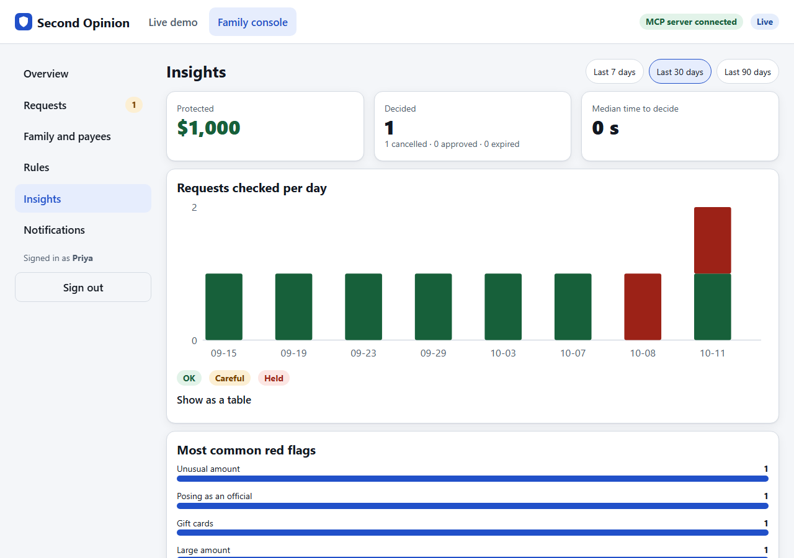

**Notifications**: what the family was sent (delivery is simulated and rendered as an inbox and HTML emails).

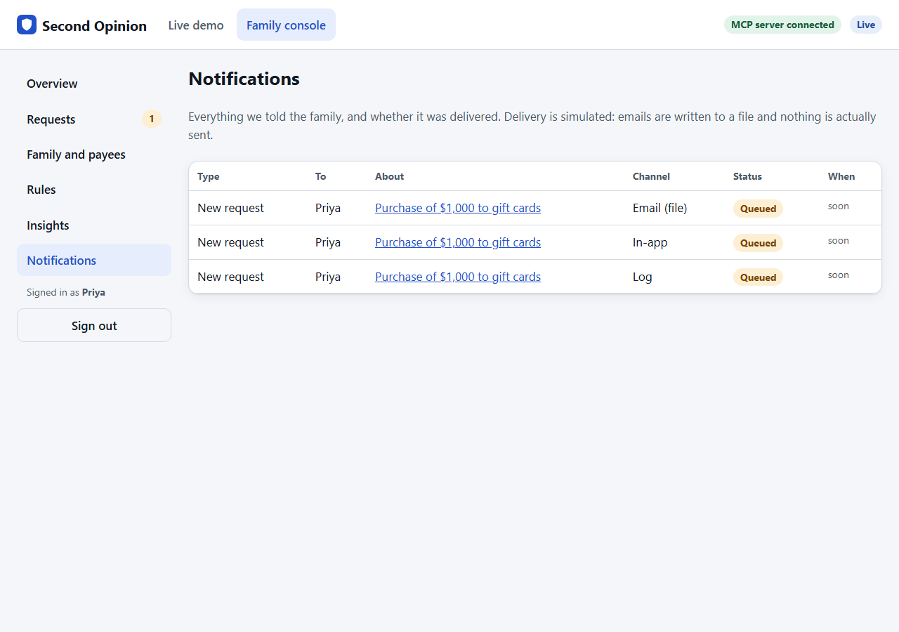

### 8. It works on a phone
Both the demo and the console are responsive and accessibility-checked (axe, on every page).

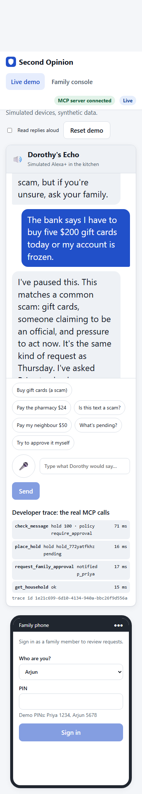

### 9. The Alexa+ screen card (MCP Apps)
Tools return a visual card (an MCP App) that hosts such as Alexa+ can render on a screen. It is authored for Alexa's 768 by 480 canvas, uses large high-contrast text, works in dark mode, and says plainly that Alexa cannot approve. Voice-only devices still get the full text.

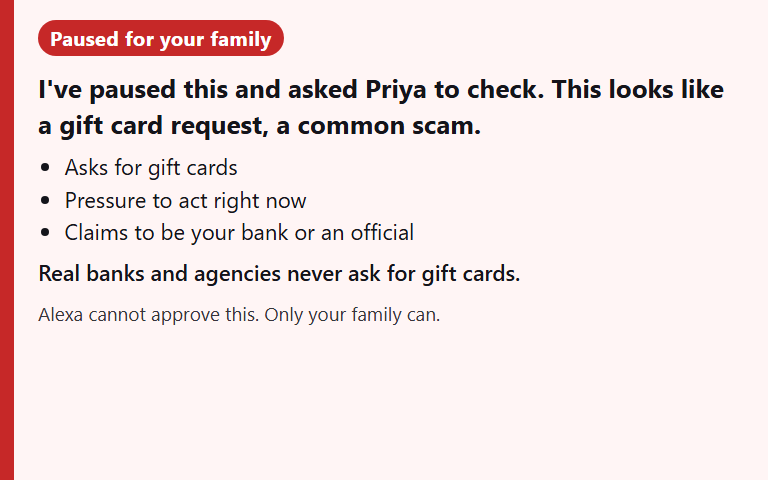

## How it works, end to end

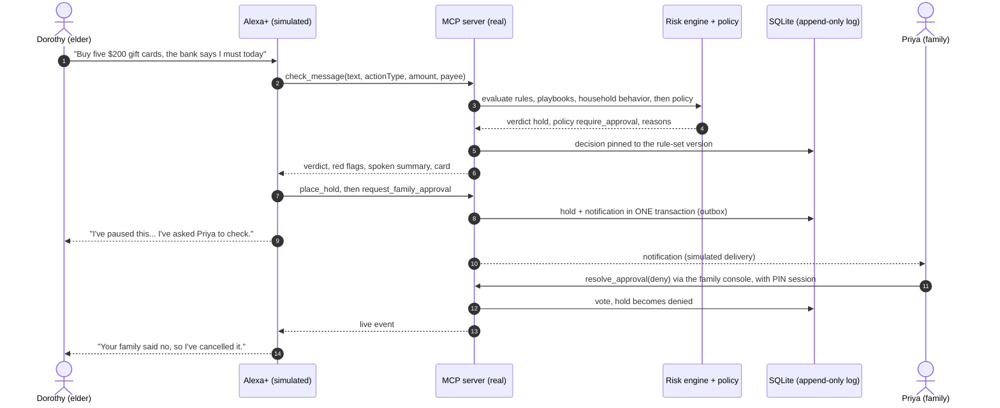

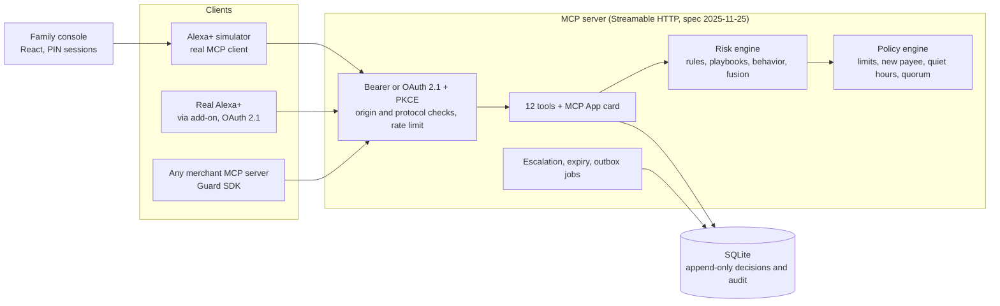

**The decision in plain steps**
1. The assistant sends the user's own words plus the action (type, amount, payee) to `check_message`.
2. The **risk engine** scores it in layers (below) and returns `allow`, `caution` or `hold` with the red flags that caused it.
3. The **policy engine** then applies the household's rules and returns `allow`, `require_approval` or `block`. It can only **tighten**: a risky request is never turned into an allowed one.
4. Anything that is not clearly fine is **held**: `place_hold` records it, `request_family_approval` queues a notification in the same database transaction (so a hold can never exist without its notification).
5. Family votes in the console. The hold is released only when enough **distinct** approvers approve; one denial vetoes.
6. Everything is recorded in an **append-only** decision log tied to the rule-set version that made it, so any past verdict can be replayed and explained.

## What is built

### MCP server (`apps/mcp-server`)
Stateless Streamable HTTP on `/mcp` (a fresh server and transport per request), spec **2025-11-25**, SDK 1.32.1. `GET` and `DELETE` return 405, an invalid `Origin` returns 403, an unsupported protocol version returns 400, with bearer or OAuth auth and a rate limiter. Every tool has a title, an output schema, honest annotations, and returns both `structuredContent` and text. Errors are tool results the model can act on, never crashes.

| Tool | What it does |
|---|---|
| `check_message` | Scores a message or payment request, applies the household policy, returns verdict, red flags, spoken summary and policy decision. Executes nothing |
| `place_hold` | Pauses a risky or policy-flagged action. Blocked requests cannot be held |
| `request_family_approval` | Notifies an approver about a hold |
| `resolve_approval` | Records one approver's vote (family console only; assistant tokens are refused) |
| `get_hold`, `list_holds` | One hold with votes and timeline; all holds |
| `trusted_payees` | List, add or remove the household's trusted payees |
| `get_household` | Who is in the household and who can approve |
| `get_policy`, `set_policy` | Read the rules; change them (family approvers only, validated) |
| `household_insights` | Protected dollars, volume per day, top red flags |
| `list_notifications` | The family's notification inbox |

Reliability features: **idempotency keys** (a retry returns the first result), request **tracing** from the screen to the decision row (`x-request-id`), **structured JSON logs** that never contain message text at info level, **Prometheus `/metrics`**, graceful shutdown, health and readiness probes.

### Detection engine (`packages/engine`)
Deterministic and pure: the same text always gives the same answer, and every decision can be explained. **No model decides.**

| Layer | What it looks at |
|---|---|
| 1. Rules | Phrases and context: gift cards, wire or crypto, remote access, verification codes, credential requests, advance fees, family-emergency stories, prizes, authority impersonation, secrecy, urgency, unsolicited contact, high amounts, new or trusted payee. Warnings such as "we will never ask for your PIN" are **not** treated as requests |
| 2. Playbooks | 20 known scam patterns matched by idf-weighted keyword coverage ("Bank fraud-department gift card scam") with advice for each |
| 3. Household behavior | Amount far above this household's normal, several new payees recently, night-time activity, a repeat of something the family already refused |
| Fusion | Layer scores combine under per-layer caps; a few **decisive rules** (for example gift card plus any other signal) force a hold. Negative signals can reduce a score but never override a decisive rule |

**Versioned and immutable.** Detector improvements ship as a new rule set (`rules-2026.10.1` to `.4`, live is `.4`). A published version never changes (golden snapshot tests enforce it), so stored decisions stay replayable. `npm run backtest -- --candidate rules-2026.10.4 --baseline rules-2026.10.3` re-scores every stored check under two rule sets and lists who got stricter or looser before anything goes live.

### Policy engine (`packages/policy`)
Editable only by family approvers, validated before saving, and it can only add friction.

| Rule | Default |
|---|---|
| Single payment limit (above this needs approval) | $500 |
| Daily spending cap (beyond this, blocked until family acts) | $1,500 |
| Risky ("caution") requests above this need approval | $200 |
| New payee wait (first payment needs approval until this passes) | 60 minutes |
| Quiet hours (payments need approval) | 22:00 to 06:00, America/Chicago |
| Approvals needed to release a hold | 1 (can be 2); one denial vetoes |
| Escalate to the next approver after | 5 minutes |
| A pending hold expires (and stays blocked) after | 10 minutes |

### Notifications (`packages/notify`)
A **transactional outbox**: the notification row is written in the same transaction as the hold, then delivered by a background job with retry and exponential backoff. Adapters: console, database inbox, and rendered HTML email. Delivery is simulated; the architecture is the real one. Escalation and expiry jobs move holds along without anyone clicking.

### Storage (`packages/store`)
SQLite via Node's built-in `node:sqlite` (no native module to compile). Four forward-only migrations. `decisions` and `audit_events` are **append-only, enforced by database triggers**. Seeded with a fictional household (Dorothy, Priya, Arjun) and a month of ordinary payments so the behavior layer has a baseline.

### Alexa+ stand-in (`apps/simulator`)
A **real MCP client** with a deterministic intent router (pay or buy, scam question, trust a payee, status, family decision). It fails closed on any error, signs family sessions with an HMAC cookie plus a CSRF header, streams live events over SSE, and forwards the trace id to the server. The demo is exactly this component driving the real server.

### Web app (`apps/web`)
React 19 and Vite, about 96 kB gzipped: the live demo screen and the Family Console. Accessible (axe-checked on every page), responsive down to phone width, live updates without reloads.

### Guard SDK (`packages/guard-sdk`) and merchant example
Any MCP tool that moves money can be guarded in a few lines. It checks first, holds when risky, blocks when the rules say so, and **refuses to run** if the guard cannot be reached. A held order runs only after a family approval, and never twice.

```ts
import { createGuard } from '@second-opinion/guard-sdk';
const guard = createGuard({ url: process.env.SO_URL!, token: process.env.SO_TOKEN!, householdId: 'hh_demo' });
server.registerTool('place_order', { inputSchema }, guard.protect(
  async (args) => realPlaceOrder(args),     // your existing handler, unchanged
  { describe: (a) => ({ actionType: 'purchase', amountCents: a.totalCents, payee: 'FreshMart', text: a.note ?? '' }) },
));
```
See [packages/guard-sdk](packages/guard-sdk/README.md) and the working [FreshMart example](examples/freshmart-mcp), where a $900 gift-card order is held and a $24 grocery order is not.

### Agent Skill (`skills/second-opinion/SKILL.md`)
Follows the open Agent Skills layout: tells an agent when to check, how to read both the verdict and the policy outcome, to hold and ask family, to never resolve an approval itself, and to fail closed. A test keeps every tool it names in sync with the real server.

### Benchmark (`scam-script-bench`, separate repo)
A small, open, synthetic benchmark of 100 invented scripts (dev 30, held-out test 30, fresh test2 40) with a schema, validator and scorer. See the results below.

## Safety and security design
| Property | How |
|---|---|
| **Fail closed** | Any error, timeout or unreachable server means the action is **not** carried out and the person is told it could not be verified (simulator, Guard SDK and Agent Skill) |
| **The assistant cannot approve** | `resolve_approval` and `set_policy` are refused for assistant (OAuth) tokens; approvals need a family PIN session in the console |
| **The policy only tightens** | A risk `hold` can never become `allow`; asserted by tests |
| **Append-only history** | Decisions and audit events cannot be updated or deleted (database triggers) |
| **One household per assistant token** | Checked on `householdId` and on the household of any `holdId` |
| **Auth** | Bearer token (operator) or **OAuth 2.1 authorization code + PKCE (S256)** with signed, short-lived tokens, single-use codes, rate-limited and audited link attempts |
| **Web hygiene** | Signed session cookies, CSRF header, login rate limit, no secrets in the repo (`.env.example` only), production refuses default secrets |
| **Privacy** | All data is synthetic; logs never contain message text at info level; metrics are counts only |

## How well does the detector work?
Measured on [`scam-script-bench`](https://github.com/Monolithic-Dev/scam-script-bench). Reproduce with `npm run eval -- --split dev` (needs the bench repo next to this one). Full write-up, method and the list of what was **missed and why**: [docs/eval-report.md](docs/eval-report.md).

| | Scams held (blocked until family decides) | Scams flagged | Benign wrongly **held** |
|---|---|---|---|
| `dev` split (tuned on), `rules-2026.10.3` | 86.7% | 93.3% | 0% |
| **`test` split (held out, scored once), `rules-2026.10.3`** | **46.7%** | **80.0%** | **0%** |
| fresh `test2` split, older detector `rules-2026.10.3` (written before tuning) | 30.0% | 70.0% | 0% |
| `test2`, new `rules-2026.10.4` (**not independent**: the same author wrote the rules) | 95.0% | 100% | 0% |

**Read this honestly.** The drop from dev to test is the real cost of tuning on a tiny set, and we publish it. The 95% on `test2` only shows the new rules can express those cases; it is **not** a claim about real scams. The detector learned our wording, so the held-out test and the older rule set's `test2` score are the numbers to believe. What holds up everywhere: **no benign message was ever held**, so family is not woken for false alarms. And even when a request is only *flagged*, the assistant does not carry it out. A fair next step is scripts written by people who have never seen the detector.

## Real versus simulated
| Real | Simulated |
|---|---|
| MCP server, tools, schemas, protocol | The Alexa+ voice assistant (our simulator is an MCP client standing in for it) |
| Risk engine, policy engine, approvals, audit log | Payments (no money moves) |
| OAuth 2.1 account linking, MCP App card | Family notifications (rendered to an inbox and HTML files) |
| Guard SDK and example merchant server | All household data is synthetic |
| Benchmark, scorer, CI | Voice input uses the browser's speech recognition when available |

## Alexa+ readiness
This project is **not connected to a real Alexa+ today**. What is ready is the server side, built to Amazon's Alexa+ MCP Toolkit requirements as we read them:

| Requirement | Status |
|---|---|
| Streamable HTTP, MCP spec 2025-11-25 | Done |
| OAuth 2.1 with PKCE (S256), `resource` parameter, protected-resource and authorization-server metadata, static client | Done and tested ([apps/mcp-server/src/oauth.ts](apps/mcp-server/src/oauth.ts)) |
| Visuals through the MCP Apps standard | Done (`ui://second-opinion/card.html`), rendered in a browser with a stand-in host, not yet on a real device |
| Add-on package | Template in [alexa-addon/addon.json](alexa-addon/addon.json) (needs artwork and URLs) |
| Public HTTPS URL, under 500 ms round trip | Needs a tunnel and measurement |

The connection steps and open questions are in [docs/alexa-integration.md](docs/alexa-integration.md). We will not claim a live connection unless it has actually been made.

## Testing and CI
| Suite | Count | Command |
|---|---|---|
| Server-side: engine, policy, store, notify, MCP tools over a real client, OAuth, card, Guard SDK, simulator, eval, backtest | 267 | `npm run test:node` |
| Web (components and hooks) | 33 | `npm run test:web` |
| Real browser (Playwright), including a two-approver flow and axe accessibility scans of every page | 17 | `npm run e2e` |

Highlights: frozen golden tests for every published rule set, a contract test that the MCP tool list and schemas do not drift, property-based tests on the engine, idempotency and fail-closed tests, and a regression gate that the live rule set keeps dev recall at or above 80% with false holds at or below 10% (it runs whenever the bench repo is checked out). GitHub Actions runs typecheck, tests and the browser tests on every pull request; `main` is a linear history merged through per-feature pull requests.

Regenerate the screenshots from the live stack: `UPDATE_SCREENSHOTS=1 npx playwright test`.

## Configuration
Copy `.env.example` to `.env`. The main settings:

| Variable | Purpose | Default |
|---|---|---|
| `MCP_PORT`, `SIM_PORT` | Ports for the MCP server and the demo | 3001, 3000 |
| `MCP_AUTH_TOKEN` | Operator bearer token (24+ characters in production) | `dev-token` |
| `DB_PATH` | SQLite file | `./data/second-opinion.db` |
| `SESSION_SECRET`, `FAMILY_PINS` | Family console sessions and demo PINs | dev values (refused in production) |
| `MCP_ALLOWED_ORIGINS`, `MCP_RATE_LIMIT_PER_MIN` | Origin allow-list and rate limit | localhost, 600 |
| `NOTIFY_CHANNELS`, `JOBS_INTERVAL_MS` | Notification adapters and background job interval | console,db,email_html; 15000 |
| `OAUTH_CLIENT_ID`, `OAUTH_CLIENT_SECRET`, `OAUTH_REDIRECT_URIS`, `OAUTH_SIGNING_KEY`, `OAUTH_LINK_CODE`, `PUBLIC_URL` | Turn on OAuth account linking for Alexa+ | off |
| `FIXED_NOW` | Freeze the server clock (tests and demos only; refused in production) | unset |

## Project layout
```
second-opinion/
  apps/
    mcp-server/      MCP server: tools, OAuth, MCP App card, HTTP guards, jobs, metrics
    simulator/       Alexa+ stand-in: MCP client, intent router, family sessions, live events
    web/             React app: live demo + Family Console
  packages/
    shared/          Types, errors, ids, clock
    engine/          Risk engine: rules, playbooks, behavior, fusion, versioned rule sets
    policy/          Household policy, decision, quorum, escalation
    store/           SQLite (node:sqlite), migrations, repositories, seed
    notify/          Transactional outbox, adapters, templates
    guard-sdk/       Wrap any MCP money tool: check, hold, fail closed
  examples/freshmart-mcp/   A merchant MCP server using the Guard SDK
  skills/second-opinion/    Agent Skill
  alexa-addon/              Alexa+ add-on template
  eval/                     Benchmark runner and regression gate
  e2e/                      Playwright tests and screenshot generator
  scripts/                  demo, seed, reset, backtest, card build
  docs/                     Specs, decisions, evaluation report, guides
```

## How this fits the track
The Alexa+ track asks for a self-hosted MCP server (spec 2025-11-25 or later, Streamable HTTP) or an Agent Skill, and welcomes a simulated Alexa+ experience in a web app.

- **MCP server:** yes, 12 tools, called at runtime by the simulator over Streamable HTTP.
- **Agent Skill:** yes, `skills/second-opinion/SKILL.md`.
- **Simulated Alexa+ in a web app:** yes, the live demo, clearly labelled as simulated.
- **Creative signals from the rules:** state across sessions (the household's history and "same as Thursday" memory), agentic orchestration (check, hold, notify, wait, release), cards and visuals (the MCP App card), and account linking (OAuth).
- **Open Source mini challenge:** the separate `scam-script-bench` dataset repo, and the Guard SDK.

## Limits and what is next
- Alexa+ cannot hear phone calls; we gate pay and buy requests and answer "is this a scam?".
- A polite request with no scam vocabulary ("send $900 to my cousin") is caught only by the household rules (new payee, large amount), not by the text.
- Detector numbers come from 100 invented, English-only scripts; they are a development yardstick, not a study. We would like independently written scripts and a language-model suggestion layer that may only *suggest* known signals, never decide.
- Elicitation (Alexa+ asking the user to confirm) and real push or SMS delivery are not implemented.
- Decision support, not a guarantee.

## Documentation index
| File | What is inside |
|---|---|
| [docs/eval-report.md](docs/eval-report.md) | Benchmark results, method, what was missed and why |
| [docs/alexa-integration.md](docs/alexa-integration.md) | What is real, what is simulated, steps to connect to Alexa+ |
| [docs/decisions.md](docs/decisions.md) | Every major decision and why |
| [docs/architecture.md](docs/architecture.md), [docs/backend-architecture.md](docs/backend-architecture.md) | Diagram, components, production decisioning blueprint |
| [docs/api-spec.md](docs/api-spec.md), [docs/mcp-best-practices.md](docs/mcp-best-practices.md) | MCP tools and how we followed the spec |
| [docs/detection-engine.md](docs/detection-engine.md), [docs/policy-and-approvals.md](docs/policy-and-approvals.md) | Signals, layers, policy, quorum |
| [docs/data-model.md](docs/data-model.md) | SQLite schema and migrations |
| [docs/simulator.md](docs/simulator.md), [docs/family-console.md](docs/family-console.md), [docs/ux-flows.md](docs/ux-flows.md) | Stand-in, console, UX |
| [docs/guard-sdk.md](docs/guard-sdk.md), [docs/agent-skill.md](docs/agent-skill.md) | SDK and skill |
| [docs/security-privacy.md](docs/security-privacy.md), [docs/edge-cases.md](docs/edge-cases.md), [docs/testing.md](docs/testing.md) | Threats, failure cases, test strategy |
| [docs/deployment.md](docs/deployment.md), [docs/observability-and-quality.md](docs/observability-and-quality.md) | Docker, metrics, CI |
| [docs/demo-script.md](docs/demo-script.md), [docs/devpost-submission.md](docs/devpost-submission.md), [docs/friction-log.md](docs/friction-log.md), [docs/submission-checklist.md](docs/submission-checklist.md) | Video outline, submission text, friction log, checklist |
| [AGENTS.md](AGENTS.md), [CLAUDE.md](CLAUDE.md) | Instructions for coding agents |

## License
MIT. See [LICENSE](LICENSE). All data is synthetic; this is decision support, not a guarantee.
