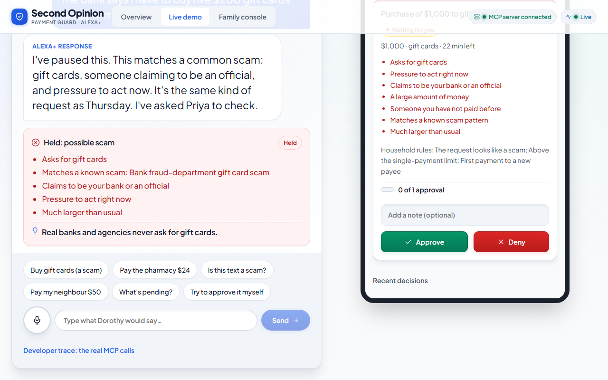
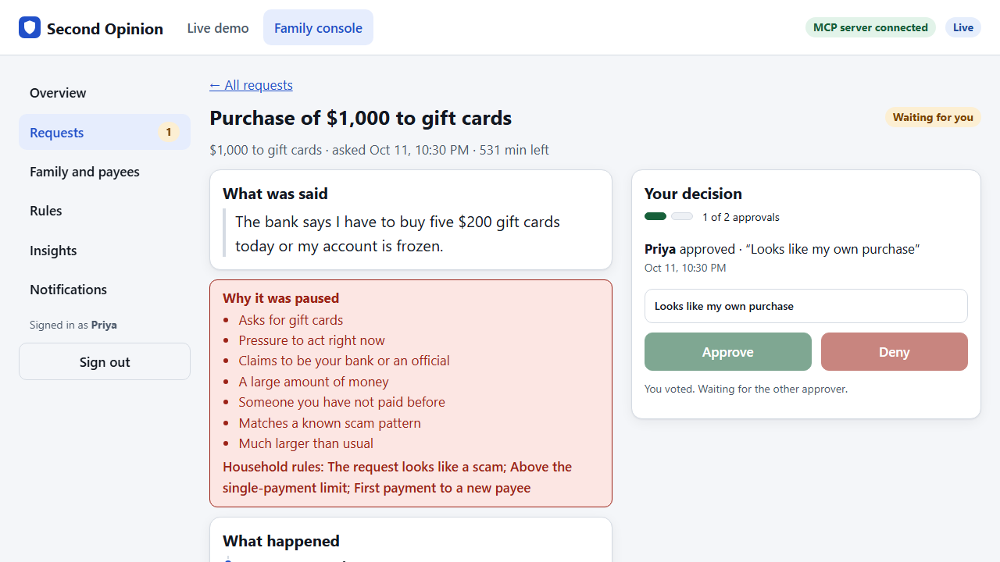

# Second Opinion

> Before a vulnerable person acts on a suspicious call, text or payment request, Alexa+ gives a spoken second opinion and **holds the action until a trusted family member approves**.

Built for the **Build, Ship, Shape: Amazon Developer Hackathon 2026**, Alexa+ track (plus the AWS Builder and Open Source mini challenges).



## The problem
Scams push older adults to pay *now*: gift cards, wire or crypto, a fake "bank security" call. Family usually finds out afterwards. Second Opinion sits at the moment a payment or purchase is requested through the home voice assistant, explains the red flags in plain language, pauses the action, and asks family to decide.

## Run it (about 2 minutes, no AWS account, no network)
```bash
git clone https://github.com/Monolithic-Dev/second-opinion && cd second-opinion
npm install
npm run demo            # builds the web app on first run, then opens everything on http://localhost:3000/demo
```
Click **Buy gift cards (a scam)** on Dorothy's Echo, sign in on Priya's phone (demo PIN `1234`), and press **Deny**. Dorothy's device tells her, live. Then open **Family console** for the full caregiver view (Arjun's demo PIN is `5678`; turn on two approvals under *Rules* to try the two-person flow).

## What is built
- **MCP server** (spec 2025-11-25, Streamable HTTP, stateless): 12 tools (`check_message`, `place_hold`, `request_family_approval`, `resolve_approval`, `trusted_payees`, `list_holds`, `get_hold`, `get_household`, `get_policy`, `set_policy`, `household_insights`, `list_notifications`). Every tool has a title, an output schema and honest annotations; errors are tool results the model can act on.
- **Layered, explainable detection** (no model decides): rules, 20 scam playbooks, household behavior (unusual amount, new payees, night hours, retry after "no"), fused under per-layer caps. Every decision is pinned to a rule-set version in an **append-only** log.
- **Household policy engine**: single-payment limit, daily cap, new-payee cool-off, quiet hours, two-approver quorum with veto, escalation. The policy can only add friction, never remove it.
- **Transactional outbox** for family notifications with retry and backoff, plus escalation and expiry jobs. Delivery is simulated (HTML email rendered to a file).
- **Simulator** (Alexa+ stand-in): a real MCP client, deterministic agent, live events, signed family sessions, fail-closed on any error.
- **Web app** (React, ~96 kB gzipped): the live demo screen and the **Family Console** (overview with protected dollars, requests, request detail with votes and timeline, family and trusted payees, household rules with validation, insights, notification inbox). Accessible (axe-checked on every page), works at phone width.


- **Reliability**: idempotency keys, request tracing from the screen to the decision row, tamper-evident audit log.

## How good is the detector?
Measured on a 60-script benchmark ([`scam-script-bench`](https://github.com/Monolithic-Dev/scam-script-bench), full write-up in [docs/eval-report.md](docs/eval-report.md)):

| | Scams held (blocked until family decides) | Scams flagged | Benign wrongly **held** |
|---|---|---|---|
| dev split (tuned on) | 86.7% | 93.3% | 0% |
| **test split (held out, scored once)** | **46.7%** | **80.0%** | **0%** |

The drop from dev to test is the honest cost of tuning on a tiny set, and we publish it with the list of what was missed and why. The scam-playbook layer is what generalises (+13 points held on test over rules alone). No benign message was ever held. Rule sets are immutable and version-pinned (`rules-2026.10.1` to `.3`), a regression gate in CI protects quality, and the numbers are reproducible with `npm run eval`.

## Honest limits
Alexa+ cannot intercept phone calls; we gate pay/buy requests and answer "is this a scam?". The Alexa+ experience is **simulated**; payments are **simulated**; family notification is **simulated**; all data is **synthetic**. A polite scam with no scam vocabulary ("send $900 to my cousin") is not caught by the playbook layer. Decision support, not a guarantee.

## Verify it
```bash
npm run typecheck && npm test    # 205 server tests + 33 web tests
npm run e2e                      # 17 real-browser tests (Playwright), incl. the two-approver flow and accessibility scans of every page
```

## Docs index (`docs/`)
| File | What's inside |
|---|---|
| [expansion-scope.md](docs/expansion-scope.md) | **Start here:** tiers, gates, what judges see |
| [backend-architecture.md](docs/backend-architecture.md) | Production decisioning blueprint: versioned rules, decision log, idempotency, shadow mode, outbox |
| [prd.md](docs/prd.md) · [acceptance-criteria.md](docs/acceptance-criteria.md) | Requirements and EARS acceptance criteria |
| [architecture.md](docs/architecture.md) · [project-structure.md](docs/project-structure.md) | Diagram, components, repo layout |
| [api-spec.md](docs/api-spec.md) · [mcp-best-practices.md](docs/mcp-best-practices.md) | MCP tools and HTTP API; how we followed the MCP spec |
| [detection-engine.md](docs/detection-engine.md) · [policy-and-approvals.md](docs/policy-and-approvals.md) | Signals, layers, policy, quorum, notifications |
| [data-model.md](docs/data-model.md) | SQLite schema and migrations |
| [simulator.md](docs/simulator.md) · [family-console.md](docs/family-console.md) · [ux-flows.md](docs/ux-flows.md) | Alexa+ stand-in, family console, UX |
| [guard-sdk.md](docs/guard-sdk.md) | Reusable gate for any MCP server |
| [security-privacy.md](docs/security-privacy.md) · [edge-cases.md](docs/edge-cases.md) · [testing.md](docs/testing.md) | Threats, failure cases, test strategy |
| [observability-and-quality.md](docs/observability-and-quality.md) · [deployment.md](docs/deployment.md) | Logs, metrics, CI, Docker |
| [roadmap.md](docs/roadmap.md) · [phases/](docs/phases) · [demo-script.md](docs/demo-script.md) | Plan, runbooks, video outline |
| [rules-digest.md](docs/rules-digest.md) · [submission-checklist.md](docs/submission-checklist.md) · [decisions.md](docs/decisions.md) | Hackathon rules, what to submit, decision log |
| [AGENTS.md](AGENTS.md) · [CLAUDE.md](CLAUDE.md) · [spec-conventions.md](docs/spec-conventions.md) | Instructions for coding agents |

## Team
Roles (lenses): Backend/MCP · Frontend/simulator · Data/QA/docs. _(fill in names)_

## License
MIT, see [LICENSE](LICENSE).
