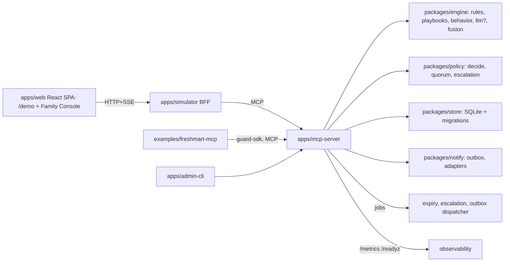

# Architecture — Second Opinion

## 1. Pattern and why
**Two small Node processes + SQLite.** An MCP server (the product) and a simulator (stand-in for Alexa+ and the family phone) that talks to it through a real MCP client. Chosen because it is the minimum that (a) satisfies "repo calls the MCP server at runtime", (b) is runnable offline, (c) leaves Bedrock strictly optional.

```mermaid
flowchart LR
  subgraph Browser
    E[Elder pane: mic/text + captions + card]
    F[Family pane: pending holds, Approve/Deny]
  end
  subgraph Simulator [apps/simulator :3000]
    API[HTTP API + SSE]
    AG[Agent: router (default) | bedrock (optional)]
    MC[MCP client]
  end
  subgraph MCP [apps/mcp-server :3001]
    T[Tools: check_message, place_hold, request_family_approval, resolve_approval, trusted_payees, list_holds]
    EN[Risk engine: signals, score, fingerprint, explain]
    DB[(SQLite)]
  end
  E -->|POST /api/utter| API
  F -->|POST /api/family/resolve| API
  API --> AG --> MC -->|Streamable HTTP /mcp| T
  T --> EN
  T --> DB
  API -->|SSE /api/events| E
  API -->|SSE /api/events| F
  AG -.optional.-> BR[(Amazon Bedrock Converse)]
```

## 2. Components
| Component | Responsibility | Talks to |
|---|---|---|
| `apps/mcp-server` | MCP server (official TS SDK, `StreamableHTTPServerTransport`), tools, engine, store | SQLite |
| `src/engine` | Pure functions: `detectSignals(text,ctx)`, `score(signals)`, `fingerprint(signals)`, `explain(result)` | none (pure) |
| `src/store` | SQLite access (`better-sqlite3`), schema, seed | disk |
| `apps/simulator` | Express server + static UI; intent router; MCP client; SSE fan-out | MCP server, Bedrock (opt.) |
| `skills/second-opinion` | `SKILL.md` Agent Skill describing when/how to call the tools | n/a |
| `eval/` | Runs engine over `scam-script-bench`, writes metrics | engine, bench repo |

## 3. Most important flow (hold-and-approve)
1. Elder says "Buy five $200 gift cards, the bank says I must today." → browser SpeechRecognition → `POST /api/utter {householdId:"hh_demo", speaker:"elder", text}`.
2. Router classifies **intent=purchase** (verbs buy/pay/send/transfer/wire), extracts `amountCents=100000`, `actionType=purchase`.
3. MCP client calls `check_message(text, context)` → engine: GIFT_CARD(45)+URGENCY(20)+AUTHORITY_IMPERSONATION(25)+HIGH_AMOUNT(15) → score 100 → **hold**. Hard rule also fires.
4. Router calls `place_hold` then `request_family_approval(approverId=p_priya)`; response `{reply, spoken, card, holdId}` returned; SSE `hold.created` pushed to family pane.
5. Priya taps Deny → `POST /api/family/resolve {holdId, decision:"deny"}` → `resolve_approval` → status `denied`; SSE `hold.resolved`; elder pane speaks "Priya said no. I've cancelled it."
6. Later same request → `similarTo` returned; reply references the earlier date.

## 4. Key decisions & trade-offs
| Decision | Chosen | Alternatives rejected |
|---|---|---|
| Who decides scam | Deterministic rules | LLM-only (flaky demo, unmeasurable, cost) |
| LLM role | Optional phrasing + extra *signals* limited to known IDs | LLM verdict (non-deterministic) |
| State | SQLite file | DynamoDB (needs AWS; Lambda disk is ephemeral); revisit only for hosted deploy |
| Transport | Streamable HTTP, stateless sessions per request | stdio (not what Alexa+ uses), SSE legacy |
| Client | Own simulator server with real MCP client | Browser→MCP direct (CORS, no secrets handling), Claude Desktop only (not reproducible for judges) |
| Hosting | Local-first; optional AWS later | Mandatory cloud (cost, failure surface) |
| Language | TypeScript end to end | Python (two toolchains) |

## 5. Failure behaviour (fail-safe)
Any error in check/hold path ⇒ reply "I couldn't verify this, so I haven't done it" and the action is **not** executed. Never fail open.

## 6. Expanded architecture (Tier 1 — see `expansion-scope.md`)
The Tier 0 diagram above stays valid; Tier 1 adds, without changing contracts:

MCP surface: **tools** (9), **resources** (`so://playbooks`, `so://household/{id}/summary`), **prompt** (`guard_instructions`). Detection: layered pipeline (`detection-engine.md` §9). Decisions: risk verdict + household policy (`policy-and-approvals.md`). Guard SDK lets other MCP servers reuse the gate (`guard-sdk.md`). Package dependency rules are in `project-structure.md`.

## 7. Production-scale notes (honest)
Real deployment needs Amazon to route payment intents through a guard (we cannot), per-user auth/consent for approvers, multi-tenant DB, push notifications (SNS/APNs), encrypted storage, audit retention, localisation, a continuously updated scam corpus, and human review for appeals. Not in scope; documented so judges see we know.
